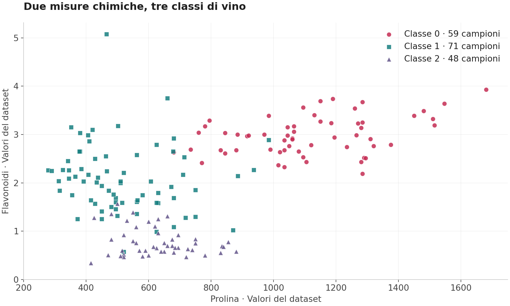
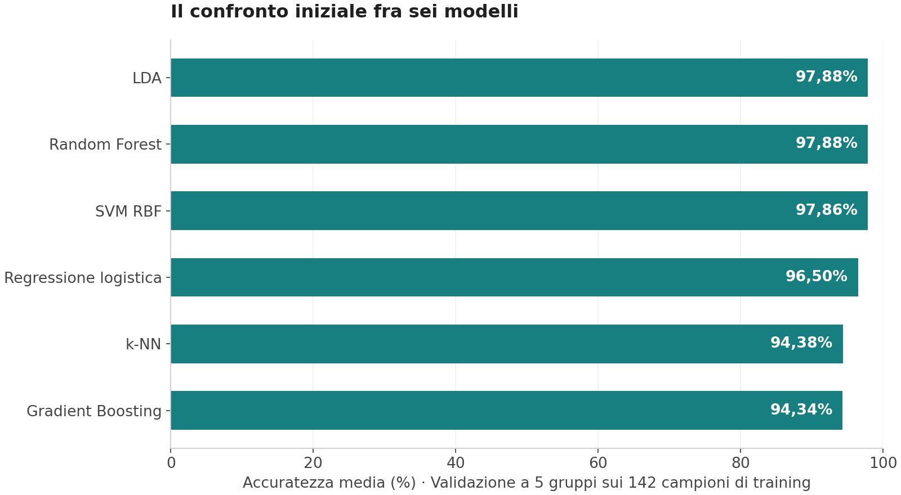
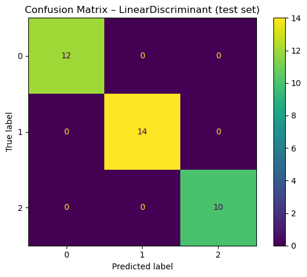

# Classificare i vini attraverso i dati chimici

**Testo approvato da Stefano il 18 settembre 2026. Pagina: `/analisi-dati/classificazione-vini/`.**

Ho confrontato sei modelli di machine learning per riconoscere tre classi di vino a partire da 13 misure chimiche. È un progetto didattico su dati pubblici: dalla lettura del dataset alla preparazione dei modelli, fino al confronto dei risultati e delle variabili che contribuiscono alle classificazioni.

## Che cosa deve riconoscere il modello

Ho utilizzato Wine, un dataset dell'archivio UCI disponibile anche in scikit-learn. Raccoglie 178 campioni di vini prodotti nella stessa regione italiana e derivati da tre diverse varietà di vite. Le classi indicano queste varietà, non un voto alla qualità del vino.

Ogni campione è descritto da 13 misure, tra cui alcol, acido malico, flavonoidi, intensità del colore e prolina. Il compito del modello è usare questi valori per assegnare il campione alla classe corretta.

## Conoscere i dati prima di addestrare

Ho controllato valori mancanti, duplicati, distribuzione delle classi e relazioni tra le variabili. Il dataset è completo e non contiene righe duplicate. Le tre classi, numerate da 0 a 2 nel notebook, comprendono rispettivamente 59, 71 e 48 campioni.

*Grafico ricostruito dal dataset Wine. Ogni punto rappresenta un campione; colori e simboli distinguono le classi. Sono mostrate due delle 13 variabili utilizzate dai modelli.*

Già osservando prolina e flavonoidi emergono differenze tra i gruppi, insieme ad alcune sovrapposizioni. Nel notebook ho esaminato tutte le variabili e le loro correlazioni, per capire quali informazioni stavo fornendo ai modelli.

Ho considerato anche i valori estremi e confrontato una versione dei dati che li escludeva. Nel lavoro successivo ho mantenuto il campione completo, affiancando due metodi per riportare le variabili su scale confrontabili: StandardScaler e RobustScaler.

## Un confronto fra sei modelli

Ho suddiviso i dati in 142 campioni per sviluppare i modelli e 36 per le verifiche, mantenendo le proporzioni delle tre classi. Sui primi 142 ho confrontato regressione logistica, LDA, k-NN, SVM, Random Forest e Gradient Boosting.

Per il confronto iniziale ho usato una validazione a cinque gruppi: a turno, quattro servono per addestrare e uno per valutare. La trasformazione delle variabili è inserita nella stessa procedura del modello e viene calcolata sui dati usati per addestrarlo in ciascuna prova.

*Grafico ricostruito dai risultati salvati nel notebook: validazione a cinque gruppi con StandardScaler. Le percentuali indicano la quota media di classificazioni corrette, non prestazioni misurate su nuovi dati esterni.*

LDA, Random Forest e SVM ottengono risultati molto vicini, intorno al 97,9%. Una differenza di pochi centesimi di punto non basta per dichiarare un vincitore. Ho approfondito LDA e Random Forest, confrontando diverse impostazioni e osservando anche quanto variassero i risultati tra le prove.

## Leggere il risultato sui 36 campioni

*Immagine originale del notebook. Le righe indicano le classi reali, le colonne quelle previste. I valori sulla diagonale contano le classificazioni corrette; quelli fuori dalla diagonale contano gli errori.*

Nella verifica riportata, LDA classifica correttamente tutti i 36 campioni tenuti fuori dall'addestramento. Anche le configurazioni di Random Forest esaminate nel notebook ottengono 36 risposte corrette su 36.

È un risultato riferito a un campione piccolo. Inoltre, durante il lavoro ho consultato più volte lo stesso insieme di verifica, confrontando diverse configurazioni: va quindi letto come valutazione interna. Per misurare le prestazioni su nuovi vini servirebbero campioni raccolti separatamente e mai utilizzati nelle scelte del modello.

## Quali variabili contribuiscono alle classificazioni

Con Random Forest ho esaminato anche l'importanza assegnata alle variabili. Nel modello analizzato, prolina, flavonoidi e intensità del colore occupano i primi tre posti. Questa lettura aiuta a capire quali misure il modello usa maggiormente per distinguere le classi, senza attribuire loro un significato causale o un giudizio sulla qualità del prodotto.

Il progetto mi ha permesso di seguire l'intero lavoro su un problema di classificazione: esplorare i dati, preparare un confronto riproducibile, regolare i modelli e interpretare risultati e limiti della valutazione.

**Strumenti utilizzati:** Python, pandas, NumPy, scikit-learn, Matplotlib e Seaborn.

## Dati e riferimenti

- [Wine nell'archivio UCI](https://archive.ics.uci.edu/dataset/109/wine): dataset di S. Aeberhard e M. Forina, distribuito con licenza CC BY 4.0.
- [Wine in scikit-learn](https://scikit-learn.org/stable/modules/generated/sklearn.datasets.load_wine.html): documentazione del dataset usato nel notebook.

---

## Note di revisione, escluse dalla pagina pubblica

- Testo approvato il 18 settembre 2026. Titolo card: «Classificare i vini attraverso i dati chimici». Descrizione proposta: «Sei modelli a confronto su 178 campioni di vino, dalla preparazione dei dati alla lettura dei risultati.»
- Fonte principale: `STENO/biblioteca/corsi/05_START2IMPACT/01_DATA_SCIENCE/09_ML_Adv_wineproject/01_CORRETTO/CORRETTO_StefanoNoccoMLAdv_01.ipynb`, 119 celle con output. La vecchia pagina WordPress 3648 contiene lo stesso progetto esportato in HTML, con sezioni duplicate e una presentazione che confonde classificazione e qualità. Usati codice e risultati, non le interpretazioni non supportate.
- Nessun notebook eseguito, nessun modello caricato da pickle/joblib, nessun originale modificato. `fonti.json` conserva hash del notebook e del dataset; `risultati-originali.txt` riporta gli output selezionati. Nessun nuovo addestramento.
- Dataset UCI scaricato da `https://archive.ics.uci.edu/static/public/109/wine.zip`. File `wine.data`, 178 righe con 13 attributi e classe. Classi originali 1–3 convertite in 0–2 per coerenza con scikit-learn e notebook. Dati senza celle vuote o duplicati; conteggi 59/71/48 confermati sia dal dataset sia dall'output originale.
- `aggrega-dati.py PERCORSO_WINE_DATA PERCORSO_NOTEBOOK` ricrea aggregati, output selezionati, provenienza e immagine originale. `genera-grafici.py` produce i due grafici nuovi. `profili-chimici.png` è una visualizzazione preparata per il sito; `confronto-modelli.png` usa i valori salvati nel notebook; `matrice-originale.png` è il PNG della cella 63, estratto senza modifiche (521 × 470 pixel). Nella pagina non ingrandirlo oltre la larghezza nativa; prevedere un contenitore più stretto delle figure ricostruite.
- Il benchmark iniziale usa StratifiedKFold a 5 gruppi, non 50. Cella 44: StandardScaler, accuratezze medie 0.978818, 0.978818, 0.978571, 0.965025, 0.943842, 0.943350. Deviazioni standard in `risultati.json`. Cella 45: confronto RobustScaler, differisce k-NN (0.929803). Nessuna significatività statistica dimostrata tra i modelli.
- Split stratificato 80/20, random_state=0: 142 training e 36 test, supporti test 12/14/10. Report LDA cella 63 e RF cella 99: tutte le metriche pari a 1 su 36 osservazioni. Il test è consultato in più punti durante tuning e confronti, quindi non descriverlo come valutazione finale indipendente o garanzia di generalizzazione.
- Le celle 74 e 104 eseguono cross_val_score sugli stimatori già selezionati, con RepeatedStratifiedKFold(5 gruppi × 10 ripetizioni). La ricerca degli iperparametri non viene ripetuta all'interno di ogni suddivisione esterna: non è nested cross-validation, nonostante nomi e commenti del notebook. LDA 0.972512315270936 e RF 0.9740886699507391 sono verifiche interne post-selezione; non servono al racconto pubblico proposto.
- L'EDA considera il dataset completo; il confronto senza outlier usa una maschera IQR calcolata prima dello split e un insieme ridotto diverso. Non presentare quel confronto come prova rigorosa che eliminare gli outlier migliori o peggiori il modello. La procedura finale conserva i 178 campioni; gli scaler nei modelli sono correttamente dentro pipeline.
- Il dataset rappresenta cultivar, non punteggi di degustazione, qualità percepita, provenienza geografica diversa, vini biologici o certificazione di filiera. Non identificare nomi delle varietà che la fonte non fornisce. L'azienda green della premessa è uno scenario didattico, non un cliente effettivo.
- Le feature importance RF sono riduzioni d'impurità del modello; non effetti causali e non importanze universali. Cella 101: prolina 0.180, flavonoidi 0.171, intensità del colore 0.170. Evitare le interpretazioni troppo nette del vecchio testo e le unità non documentate nei metadati UCI.
- Non è stata individuata una pubblicazione Kaggle di questo notebook. Le fonti pubbliche della bozza sono dataset e documentazione, senza inventare un link al codice. La copia locale resta disponibile per un'eventuale pubblicazione separata concordata con Stefano.
- Implementazione: aggiunta la pagina e una sesta card all'hub Analisi dati; aggiornato il redirect da `/portfolio/analisi-dati/wine-quality-classifier-in-python/`. Aggiunto un test per verificare la destinazione dedicata, distinta da Wine Enthusiast.
- Non modificare la ricerca sulla Sardegna. Dopo questa pagina si riprende la revisione dei progetti di Sviluppo.
