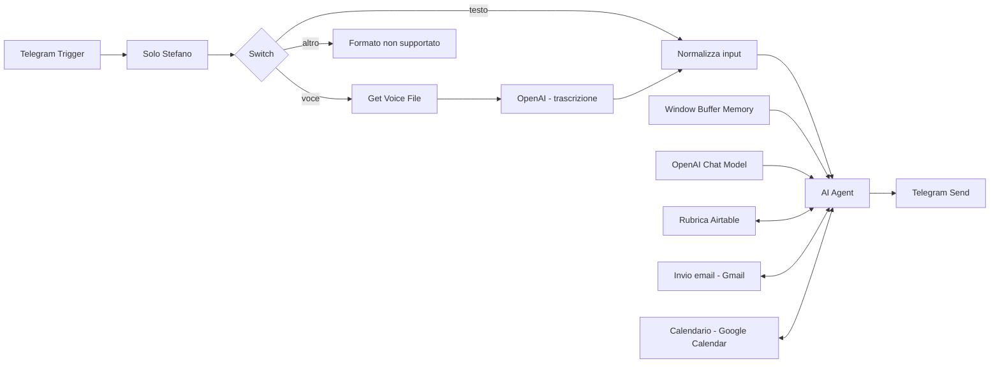

# Assistente personale con strumenti - Stefano Nocco

## Obiettivo e stato

Gestire email e appuntamenti da una chat Telegram, con richieste scritte o vocali. Il workflow riprende l'elaborato già iniziato da Stefano. È attivo su n8n Cloud e ha completato undici esecuzioni reali il 7 e 8 ottobre 2026. Il video finale dura 2:30, include riprese reali e avatar personale HeyGen; il PDF approfondito contiene il link accessibile.

## Architettura

Il filtro della chat privata precede l'accesso al modello. Testo e trascrizione confluiscono nel campo `input_text`. L'agente usa `gpt-4o-mini`, memoria per chat con finestra 10 e tre strumenti. Airtable è usato in lettura; Gmail invia; Google Calendar crea eventi. Data e ora correnti sono calcolate con `$now` in `Europe/Rome`; i parametri delle azioni sono prodotti tramite `$fromAI`.

Telegram usa il token Bot API già salvato in n8n; Gmail, Calendar e Airtable usano credenziali OAuth. Chat e trascrizione funzionano attraverso i Gateway credits n8n. Nessuna chiave o credenziale è inclusa nell'export portabile.

## Prove reali

| Esecuzione | Caso | Risultato osservato |
| --- | --- | --- |
| 1 | Avvio `/start` | Risposta ricevuta in Telegram |
| 2 | Ricerca Contatto Prova S2I | Email letta dalla rubrica Airtable |
| 3 | Bozza testuale | Bozza in chat, nessun invio |
| 4 | Invio della bozza precedente | Un messaggio Gmail; email ricevuta in Outlook |
| 5 | Evento personale | Rubrica poi Calendar; 8 ottobre, 15:00-15:30, nessun invitato |
| 6 | Nota vocale | Download, trascrizione, rubrica e bozza; nessun invio |
| 7 | Contatto assente | Assenza segnalata, nessun indirizzo inventato o invio |
| 8 | Orario mancante | Richiesto l'orario, nessun evento creato |
| 9 | Sticker | Risposta per formato non supportato; nessuna chiamata al modello |
| 10 | Email durante la demo | Nuova lettura Airtable, una email ricevuta in Outlook |
| 11 | Evento durante la demo | Nuova lettura Airtable, 9 ottobre 16:00-16:30, nessun invitato |

Tutte hanno stato n8n `success`. Nel vocale il provider riporta 12 secondi di audio; il testo trascritto conserva la richiesta di preparare una bozza senza inviarla. L'email di prova è stata ricevuta nello spam e poi spostata in Posta in arrivo da Stefano. Il corpo contiene il testo richiesto e il footer automatico n8n. L'evento è stato verificato anche nell'interfaccia Google Calendar.

Il registro [prove_reali.json](evidenze/prove_reali.json) documenta input, output, tempi e sequenza degli strumenti. I log integrali rimangono in `config_locale/`; le schermate condivisibili sono in `evidenze/`.

## Revisione emersa dalle prove

L'esecuzione 4 ha inviato al destinatario corretto usando il contatto già letto nelle esecuzioni 2 e 3, senza una nuova chiamata Airtable nel turno di invio. Dopo questo risultato, il system prompt è stato rafforzato: ogni singola richiesta di email o evento deve richiamare la rubrica nella richiesta corrente. Nell'esecuzione 5 il modello ha rispettato la sequenza rubrica-calendario. Il secondo invio è stato verificato nell’esecuzione 10: Airtable precede Gmail. La stessa sequenza è verificata nell’11 per Calendar.

Le regole di bozza, conferma del successo, contatti e orari sono istruzioni al modello, non vincoli deterministici sugli strumenti. Il filtro della chat, invece, è codice eseguito prima dell'agente. La memoria è contestuale e non costituisce un archivio permanente garantito.

## Validazione locale e limiti

Importazione n8n 2.37.0 e 12 controlli locali superati. Verificati espressioni, normalizzazione, date, invitati, escape HTML, collegamenti e filtro delle chat. Il validatore MCP segnala l'espressione degli invitati come stringa; l'espressione restituisce un array, verificato localmente, e l'evento reale senza invitati è riuscito.

Non sono stati simulati online guasti dei servizi né contatti omonimi; non sono stati mandati inviti a terzi. Non è misurata l'affidabilità su una popolazione di richieste. Il modello può ancora produrre asterischi Markdown visibili nel testo Telegram: limite estetico osservato. L'operatività dipende dalla disponibilità dei crediti e delle credenziali dei servizi.

## Consegna

[Video finale di 2:30](https://www.loom.com/share/6df5343a8a194c3f88e6df64413976ac): tutti i nodi aperti, richiesta Telegram, email ricevuta, seconda richiesta ed evento verificato. Avatar e voce generati con HeyGen, dichiarati a schermo. PDF di 10 pagine con spiegazioni, prove e link, verificato visivamente. Nessun elaborato è stato caricato su start2impact.
